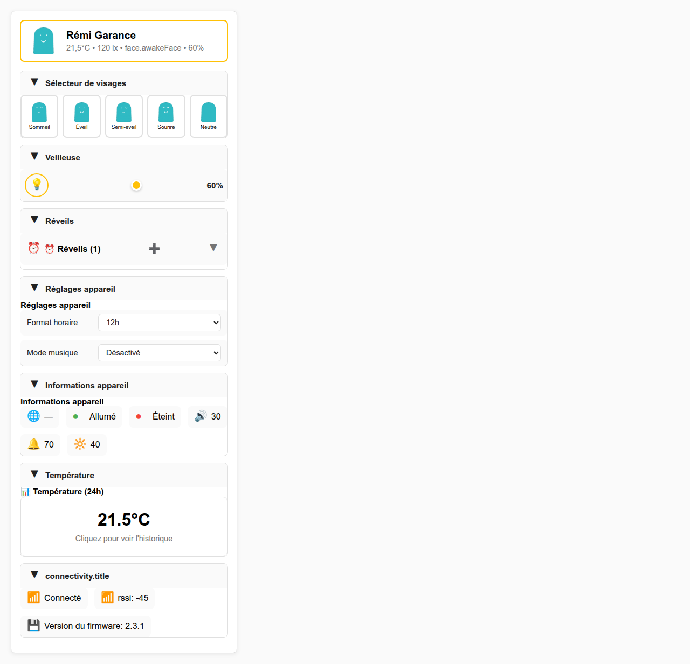
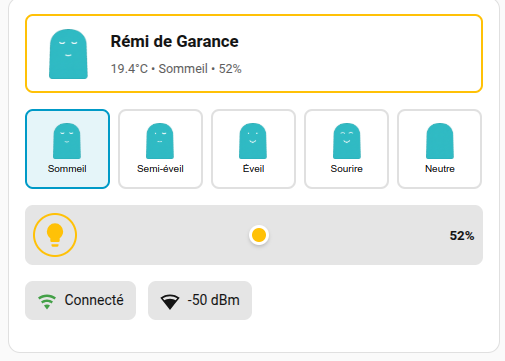

# Rémi Card

[](https://www.home-assistant.io/integrations/marketplace/)
[](https://github.com/homeassistant-fr-ecosystem/remi-card/actions/workflows/validate.yml)
[](https://github.com/homeassistant-fr-ecosystem/remi-card/releases/latest)
[](https://github.com/homeassistant-fr-ecosystem/remi-card/blob/main/LICENSE)

A custom Lovelace card for Home Assistant to display and control Rémi UrbanHello baby sleep trainer devices.

## Preview



## Features

- 🎨 **Visual Face Display**: Shows current Rémi face state with images
- 😊 **Face Selector**: Interactive face selection (Sleep, Semi-awake, Awake, Smile, Neutral)
- 💡 **Brightness Slider**: Smooth brightness control with on/off toggle (0-100%)
- 🌡️ **Temperature Monitoring**: Current temperature with clickable graph access
- 📶 **Connectivity Status**: WiFi connection and signal strength
- 🖱️ **UI Editor Support**: Full visual configuration editor in Home Assistant
- ⚙️ **Configurable**: Show/hide sections as needed

## Installation

### HACS (Recommended)

1. Open HACS
2. Go to "Frontend"
3. Click the menu (three dots) in the top right
4. Select "Custom repositories"
5. Add this repository URL and select "Lovelace" as the category
6. Click "Install"
7. Refresh your browser

### Manual Installation

1. Copy `remi-card.js` to `<config>/www/community/remi-card/`
2. Add to your Lovelace resources:

```yaml
url: /local/community/remi-card/remi-card.js
type: module
```

## Adding to Dashboard

### Visual UI Editor (Recommended)

1. Go to your dashboard
2. Click the ⋮ menu → "Edit Dashboard"
3. Click "+ ADD CARD"
4. Scroll to "Custom" section and select **"Rémi Card"**
5. Fill in the configuration:
   - **Device ID**: `garance` (required)
   - **Device Name**: `Garance` (optional)
   - Toggle options as needed
6. Click "SAVE"

### YAML Configuration

Alternatively, you can configure the card in YAML:

## Configuration

### Basic Configuration

```yaml
type: custom:remi-card
device_id: garance
device_name: Garance
```

### Full Configuration

```yaml
type: custom:remi-card
device_id: garance
device_name: Garance
show_face_selector: true
show_controls: true
show_temperature_graph: true
show_connectivity: true
hours_to_show: 24
```

## Options

| Name | Type | Default | Description |
|------|------|---------|-------------|
| `type` | string | **Required** | `custom:remi-card` |
| `device_id` | string | **Required** | Device ID suffix (e.g., `garance` for entities like `light.remi_garance_night_light`) |
| `device_name` | string | `device_id` | Display name for the device |
| `device_prefix` | string | `device_id` | Entity prefix used to discover device entities |
| `title` | string | — | Custom card title shown in the header (defaults to "Rémi {device_name}") |
| `show_face_selector` | boolean | `true` | Show face selection buttons (5 faces) |
| `show_controls` | boolean | `true` | Show light control buttons |
| `show_temperature_graph` | boolean | `true` | Show temperature section |
| `show_connectivity` | boolean | `true` | Show WiFi connectivity status |
| `show_alarm_clocks` | boolean | `true` | Show alarm clocks section |
| `hours_to_show` | number | `24` | Hours to show in temperature graph label |
| `sections` | SectionId[] | all | List of sections to display (face_selector, light_controls, alarms, device_settings, device_info, temperature_graph, connectivity) |
| `expanded_sections` | SectionId[] | all | List of sections expanded by default |

### ⚠️ Connectivity and RSSI

The **Connectivity** (`binary_sensor.*_connectivity`) and **RSSI** (`sensor.*_rssi`) entities are **disabled by default** in the `urbanhello_remi` integration. When the `remi-card` connectivity section is enabled but these entities are not enabled in Home Assistant, the card displays a message inviting you to enable them.

To enable them:

1. Go to **Settings** → **Devices & Services**
2. Select your **Rémi UrbanHello** integration
3. Find the **Connectivity** and **RSSI** entities (diagnostic)
4. Click on each and **enable** them
5. Refresh the dashboard

Once enabled, the card will show the WiFi connection status and signal strength.

### Collapsible sections

All sections are collapsible. Click a section header to expand or collapse it.
Collapsed sections show a summary (e.g. brightness %, current temperature, connectivity status).
Use `expanded_sections` to control which sections start expanded, and `sections` to choose which sections are displayed at all.

### Alarm clocks

If your Rémi device has configured alarms, they appear in the **Alarm clocks** section.
From there you can:

- Enable / disable each alarm
- Test (trigger) an alarm
- Snooze an active alarm
- Edit an alarm (toggle enabled)
- Delete an alarm
- Add a new alarm (via the "+" button)

Alarm management calls the `urbanhello_remi` services (`create_alarm`, `update_alarm`, `delete_alarm`, `trigger_alarm`, `snooze_alarm`).

## Required Entities

The card expects the following entities to exist (where `{device_id}` is your configured device ID):

- `sensor.remi_{device_id}_face` - Current face state (sensor)
- `select.remi_{device_id}_face` - Face selection control (for face selector)
- `light.remi_{device_id}_night_light` - Night light control
- `sensor.remi_{device_id}_temperature` - Temperature sensor
- `binary_sensor.remi_{device_id}_connectivity` - Connection status (optional)
- `sensor.remi_{device_id}_rssi` - WiFi signal strength (optional)

## Face Images

The card includes bundled face images in the `assets/` directory:
- `face_sleepy.png` - Sleeping face
- `face_awake.png` - Awake face
- `face_semi_awake.png` - Semi-awake face
- `face_smily.png` - Smiling face
- `face_blank.png` - Blank/neutral face

**Location:** `/local/community/remi-card/assets/`

The card automatically loads images from its own assets directory.

## Example Usage

### Single Device

```yaml
type: custom:remi-card
device_id: garance
```

 

### Compact View (Controls Only)

```yaml
type: custom:remi-card
device_id: garance
show_temperature_graph: false
show_connectivity: false
```

### Full View

```yaml
type: custom:remi-card
device_id: garance
device_name: Garance
show_controls: true
show_temperature_graph: true
show_connectivity: true
hours_to_show: 24
```

## Development

### Quick Start

```bash
npm install
npm run build
```

### Available Commands

```bash
npm run build      # Build for production
npm run watch      # Build and watch for changes
npm run lint       # Run ESLint
```

For detailed development instructions, see [CONTRIBUTING.md](CONTRIBUTING.md).

## Contributing

We welcome contributions! Please see our [Contributing Guidelines](CONTRIBUTING.md) for details on:

- Setting up your development environment
- Code standards and best practices
- Submitting pull requests
- Adding or improving translations
- Reporting bugs and requesting features

### Translation Contributions

Help make Rémi Card available in more languages! for:

- Currently supported languages (EN, FR)
- How to add a new language
- Translation quality guidelines
- Testing your translations

## Documentation

- **[README.md](README.md)** - This file, general usage and installation
- **[CONTRIBUTING.md](CONTRIBUTING.md)** - Development and contribution guidelines

## License

MIT License
